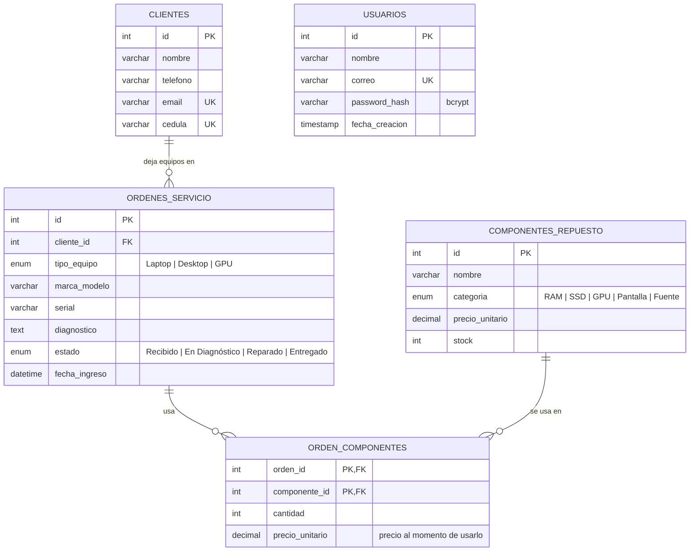

# Bancada · Gestión de órdenes de servicio técnico

Sistema empresarial para un **taller de computación y tecnología**: controla el ingreso de laptops, PCs y tarjetas gráficas para diagnóstico y reparación, gestiona a los clientes y registra los repuestos usados en cada servicio (descontando el stock automáticamente).

- **Back end:** Node.js + Express (ES Modules) · MySQL 8 · JWT + bcrypt
- **Front end:** React 19 + Vite + Tailwind CSS 4 · React Router

## Modelo de datos



**Reglas de negocio**

- No se puede eliminar un cliente con órdenes registradas ni un repuesto que ya se usó (responde `409`).
- Al agregar un repuesto a una orden se descuenta el stock dentro de una transacción. Si no alcanza, responde `409`.
- Al quitar un repuesto o eliminar una orden, las unidades regresan al inventario.

## Estructura

```
MiniProyecto1/
├── .env.example            → variables del backend (copiar como .env)
├── database/
│   ├── schema.sql          → crea la BD completa con datos de prueba
│   └── migrations/002_usuarios.sql
├── postman/                → colección con todos los endpoints y casos 400/401/404/409
├── src/                    → BACKEND
│   ├── app.js / server.js
│   ├── config/             → env.js (valida variables), db.js (pool MySQL + transacciones)
│   ├── models/             → clienteModel, ordenModel, componenteModel, usuarioModel
│   ├── controllers/        → un controlador por entidad + authController
│   ├── routes/             → rutas por entidad + authRoutes
│   ├── middlewares/        → authMiddleware (JWT), errorHandler, notFound
│   ├── validators/         → validación de entrada por entidad
│   └── utils/
└── frontend/               → FRONT END
    ├── .env.example        → VITE_API_URL
    └── src/
        ├── components/     → ui/, layout/, clientes/, ordenes/, componentes/, RutaProtegida.jsx
        ├── context/        → AuthContext.jsx (token y usuario), ToastContext.jsx
        ├── pages/          → Login, Registro, Panel, Ordenes, Clientes, Componentes
        ├── services/       → api.js (token + errores) y un servicio por entidad
        ├── hooks/ · constants/ · utils/ · styles/
```

## Instalación y ejecución

**Requisitos:** Node.js 20 o superior y MySQL 8.

### 1. Base de datos

Abre MySQL Workbench, conéctate como `root` y ejecuta `database/schema.sql` completo (Ctrl+Shift+Enter).

> El script **borra y recrea** la base `taller_servicio_tecnico`. Si ya la tenías del Día 1 y quieres conservar los datos, ejecuta solo `database/migrations/002_usuarios.sql`.

### 2. Backend (raíz del proyecto)

```bash
cp .env.example .env    # en Windows: copy .env.example .env
```

Completa `.env`:

| Variable | Ejemplo | Descripción |
|---|---|---|
| `PORT` | `3000` | Puerto de la API |
| `CORS_ORIGIN` | `http://localhost:5173` | URL del frontend |
| `DB_HOST` / `DB_PORT` | `localhost` / `3306` | Servidor MySQL |
| `DB_USER` / `DB_PASSWORD` | `root` / `tu-clave` | Credenciales MySQL |
| `DB_NAME` | `taller_servicio_tecnico` | Base de datos |
| `JWT_SECRET` | *(64+ caracteres aleatorios)* | Clave para firmar tokens |
| `JWT_EXPIRES_IN` | `8h` | Duración del token |

Genera el `JWT_SECRET` con:
```bash
node -e "console.log(require('crypto').randomBytes(48).toString('hex'))"
```

```bash
npm install
npm run dev             # http://localhost:3000
```

### 3. Frontend

```bash
cd frontend
cp .env.example .env    # VITE_API_URL=http://localhost:3000/api
npm install
npm run dev             # http://localhost:5173
```

**Usuario de demostración:** `demo@bancada.com` / `Demo12345`. También puedes crear tu cuenta en `/registro`.

## API REST

Todas las rutas, excepto `register`, `login` y `/health`, requieren el encabezado `Authorization: Bearer <token>`. Sin un token válido responden `401 { "error": "No autorizado" }`.

### Autenticación

| Método | Ruta | Respuesta |
|---|---|---|
| POST | `/api/auth/register` | `201` usuario sin password · `400` correo en uso o datos inválidos |
| POST | `/api/auth/login` | `200 { token, usuario, expiresIn }` · `401` credenciales incorrectas |
| GET | `/api/auth/me` | `200` usuario del token · `401` |

### Entidades (`/api/clientes`, `/api/ordenes`, `/api/componentes`)

| Método | Ruta | Respuesta |
|---|---|---|
| GET | `/api/<entidad>` | `200 { total, data: [...] }` |
| GET | `/api/<entidad>/:id` | `200 { data }` · `404` |
| POST | `/api/<entidad>` | `201 { message, data }` · `400` validación |
| PUT | `/api/<entidad>/:id` | `200 { message, data }` · `400` · `404` |
| DELETE | `/api/<entidad>/:id` | `200 { message }` · `404` · `409` si tiene dependencias |

Filtros: `GET /api/ordenes?estado=Reparado&cliente_id=1`, `GET /api/componentes?categoria=SSD`.
Las órdenes incluyen el objeto `cliente` y `total_repuestos`. `GET /api/ordenes/:id` también incluye `componentes`.

### Rutas adicionales de órdenes

| Método | Ruta | Descripción |
|---|---|---|
| PATCH | `/api/ordenes/:id/estado` | Cambia solo el estado `{ "estado": "Reparado" }` |
| POST | `/api/ordenes/:id/componentes` | Agrega un repuesto `{ "componente_id": 2, "cantidad": 1 }` y descuenta stock (`409` si no alcanza) |
| DELETE | `/api/ordenes/:id/componentes/:componenteId` | Quita el repuesto y devuelve el stock |

### Formato de errores

```json
{ "error": { "code": "VALIDATION_ERROR", "message": "Datos de cliente inválidos", "details": { "email": "El email no tiene un formato válido" } } }
```

## Pruebas con Postman

Importa `postman/MiniProyecto1.postman_collection.json` y ejecútala completa con el **Runner**. El request "Login OK" guarda el token automáticamente y los de creación guardan los ids que usan los siguientes. Son 41 requests, que incluyen los casos `400`, `401`, `404` y `409`, y al final eliminan los datos que crearon.

## Decisiones de seguridad

- Las contraseñas se guardan con **bcrypt** (10 rondas) y nunca se devuelven en las respuestas.
- El **JWT** lleva solo el id del usuario (`sub`), se firma con HS256 y vence según `JWT_EXPIRES_IN`.
- En el login se compara siempre contra un hash, aunque el correo no exista, para no revelar qué correos están registrados.
- El token se guarda en `localStorage`, como permite la consigna. Es simple, pero un ataque XSS podría leerlo. En producción convendría una cookie `httpOnly` + `SameSite`. Si la API responde `401`, el frontend borra el token y vuelve al login.
- Todas las consultas SQL son parametrizadas. El `.env` está en `.gitignore`.
