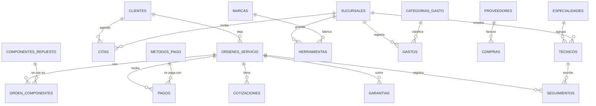

# Bancada · Gestión de órdenes de servicio técnico

Sistema empresarial para un **taller de computación y tecnología**. Registra los equipos (laptops, PC y tarjetas gráficas) que ingresan para diagnóstico y reparación, sigue cada orden por sus estados, descuenta del inventario los repuestos usados y administra clientes, técnicos, proveedores, pagos y garantías.

| Aspecto | Detalle |
| --- | --- |
| **Back end** | Node.js 20+ · Express 4 (ES Modules) · MySQL 8 · JWT + bcrypt |
| **Front end** | React 19 · Vite · Tailwind CSS 4 · React Router 7 |
| **Alcance** | **20 CRUDs** · **21 tablas** · autenticación con JWT · agente de IA · 72 pruebas en Postman |
| **IA** | Claude (API de Anthropic) con herramientas de solo lectura sobre la base de datos |
| **Proyecto** | Mini Proyecto 1 (Día 1 y Día 2) |

## Contenido

1. [Funcionalidades](#funcionalidades)
2. [Instalación y ejecución](#instalación-y-ejecución)
3. [Estructura del proyecto](#estructura-del-proyecto)
4. [Modelo de datos](#modelo-de-datos)
5. [API REST](#api-rest)
6. [Cómo funcionan los 20 CRUDs](#cómo-funcionan-los-20-cruds)
7. [Agente de IA: Bancada IA](#agente-de-ia-bancada-ia)
8. [Autenticación y seguridad](#autenticación-y-seguridad)
9. [Calidad del código y pruebas](#calidad-del-código-y-pruebas)
10. [Problemas comunes](#problemas-comunes)
11. [Documentación del proyecto](#documentación-del-proyecto)

---

## Funcionalidades

**Página de inicio pública** (`/`): presenta el sistema y lleva al registro o al login.

**Acceso:**

- Registro e inicio de sesión. Las rutas protegidas te devuelven a la página que pediste después de entrar.
- La sesión dura 8 horas. Al vencer, vuelves al login con un aviso.
- El botón **"Usar cuenta"** rellena la cuenta de demostración.

**Panel** (`/panel`): órdenes activas, en diagnóstico y listas para entregar, el flujo por estado, los repuestos con stock bajo y los últimos ingresos.

**Órdenes de servicio** (`/ordenes`):

- **Tablero** con 4 columnas (Recibido → En diagnóstico → Reparado → Entregado) y un botón para pasar cada orden al siguiente estado.
- Vista de **lista**, búsqueda y filtro por tipo de equipo.
- **Detalle** de cada orden, donde se cambia el estado y se agregan o quitan repuestos. El stock se descuenta y se repone automáticamente.

**Clientes** (`/clientes`) y **Repuestos** (`/repuestos`): CRUD con búsqueda, filtro por categoría y medidor de stock.

**Administración** (`/admin`): los 20 módulos agrupados por área.

| Área | Módulos |
| --- | --- |
| Atención y servicio | Órdenes de servicio · Clientes · Citas · Cotizaciones · Seguimientos · Garantías |
| Compras e inventario | Repuestos · Proveedores · Compras · Herramientas |
| Personal y sedes | Técnicos · Especialidades · Sucursales |
| Finanzas | Pagos · Métodos de pago · Gastos · Categorías de gasto |
| Catálogos y sistema | Servicios · Marcas · Usuarios |

**Bancada IA** (botón flotante en todas las pantallas internas): asistente que responde preguntas sobre el taller consultando los datos reales. Por ejemplo: *"¿Qué equipos están listos para entregar?"* o *"¿Cuánto ingresó este mes?"*. Ver [Agente de IA](#agente-de-ia-bancada-ia).

Todo es **responsive**:

- **Celular:** barra de navegación inferior, tablas convertidas en tarjetas y formularios que se abren desde abajo.
- **Tablet y laptop pequeña:** tarjetas en dos columnas.
- **Pantallas anchas:** tablas completas.

---

## Instalación y ejecución

**Requisitos:** [Node.js](https://nodejs.org) 20 o superior, [MySQL 8](https://dev.mysql.com/downloads/) y MySQL Workbench (opcional).

### 1. Clonar e instalar

```bash
git clone https://github.com/AngelDST13/MiniProyecto1B.git
cd MiniProyecto1B
npm install                # dependencias del backend
cd frontend && npm install && cd ..
```

### 2. Crear la base de datos

En MySQL Workbench abre **File → Open SQL Script → `database/schema.sql`** y ejecútalo completo (**Ctrl+Shift+Enter**). Crea la base `taller_servicio_tecnico` con las 21 tablas y datos de prueba.

> ⚠️ `schema.sql` **borra y recrea** la base. Si ya la tienes y quieres conservar tus datos, ejecuta solo las migraciones que te falten, en orden: `database/migrations/002_usuarios.sql` y `003_administracion.sql`.

### 3. Configurar las variables de entorno

```bash
cp .env.example .env                       # Windows: copy .env.example .env
cp frontend/.env.example frontend/.env     # Windows: copy frontend\.env.example frontend\.env
```

Completa el `.env` de la raíz:

| Variable | Ejemplo | Descripción |
| --- | --- | --- |
| `PORT` | `3000` | Puerto de la API |
| `CORS_ORIGIN` | `http://localhost:5173,http://127.0.0.1:5173` | URLs del frontend permitidas, separadas por coma |
| `DB_HOST` / `DB_PORT` | `localhost` / `3306` | Servidor MySQL |
| `DB_USER` / `DB_PASSWORD` | `root` / `tu-clave` | Credenciales de MySQL |
| `DB_NAME` | `taller_servicio_tecnico` | Nombre de la base |
| `JWT_SECRET` | *(64+ caracteres aleatorios)* | Clave para firmar los tokens |
| `JWT_EXPIRES_IN` | `8h` | Duración de la sesión |
| `ANTHROPIC_API_KEY` | *(opcional)* | Activa el agente de IA. Sin ella, el resto del sistema funciona igual |
| `AGENTE_MODELO` | `claude-opus-5-5` | Modelo de Claude que usa el agente |
| `AGENTE_ESFUERZO` | `low` | `low` (más rápido y económico), `medium` o `high` |

Genera el `JWT_SECRET` con:

```bash
node -e "console.log(require('crypto').randomBytes(48).toString('hex'))"
```

`frontend/.env` solo necesita `VITE_API_URL=http://localhost:3000/api`.

### 4. Ejecutar

```bash
npm run dev:all
```

Levanta la **API** en <http://localhost:3000> y el **frontend** en **<http://localhost:5173>**. `Ctrl+C` detiene ambos.

También puedes ejecutarlos por separado: `npm run dev` en la raíz y `npm run dev` dentro de `frontend/`.

**Cuenta de demostración:** `demo@bancada.com` / `Demo12345`. También puedes crear la tuya en `/registro`.

### Scripts disponibles

| Dónde | Comando | Qué hace |
| --- | --- | --- |
| Raíz | `npm run dev:all` | Backend + frontend juntos |
| Raíz | `npm run dev` | Solo el backend, con recarga automática |
| Raíz | `npm start` | Backend sin recarga (producción) |
| Raíz | `npm run lint` | Revisa el código del backend con ESLint |
| Raíz | `npm run lint:md` | Revisa el README y `docs/` con markdownlint |
| Raíz | `npm run test:agente` | Prueba las herramientas y el bucle del agente sin gastar en la API |
| `frontend/` | `npm run dev` | Solo el frontend |
| `frontend/` | `npm run lint` | Revisa el código del frontend con ESLint (incluye reglas de React Hooks) |
| `frontend/` | `npm run build` | Compila el frontend en `frontend/dist` |

---

## Estructura del proyecto

```text
MiniProyecto1B/
├── .env.example                 → variables del backend (copiar como .env)
├── package.json                 → scripts y dependencias del backend
├── eslint.config.js             → reglas de ESLint del backend
├── .markdownlint-cli2.jsonc     → reglas de markdownlint (README y docs)
├── scripts/                     → dev.mjs (levanta todo) · probar-agente.mjs (pruebas del agente)
├── database/
│   ├── schema.sql               → crea la base completa (21 tablas) con datos de prueba
│   └── migrations/              → 002_usuarios.sql · 003_administracion.sql
├── docs/                        → entregables: justificación, modelo ER, informe JWT, checklist
├── postman/                     → colección con los 72 requests de prueba
│
├── src/                         → BACK END
│   ├── server.js                → arranca el servidor (verifica MySQL antes)
│   ├── app.js                   → Express: CORS, JSON, rutas, errores
│   ├── config/                  → env.js (valida variables) · db.js (pool MySQL + transacciones)
│   ├── models/                  → clienteModel, ordenModel, componenteModel, usuarioModel, crudModel
│   │   └── admin/               → definición de las 17 entidades de Administración
│   ├── controllers/             → un controlador por entidad + auth, crud genérico, admin y agente
│   ├── routes/                  → rutas por entidad + auth, crud genérico, admin y agente
│   ├── services/agente/         → agenteService (bucle con Claude) · herramientas (consultas de solo lectura)
│   ├── middlewares/             → authMiddleware (JWT) · errorHandler · notFound
│   ├── validators/              → validación de entrada por entidad + genérica
│   └── utils/                   → AppError, jwt, parseId, asyncHandler
│
└── frontend/                    → FRONT END
    ├── .env.example             → VITE_API_URL
    └── src/
        ├── App.jsx              → mapa de rutas
        ├── pages/               → Inicio, Login, Registro, Panel, Ordenes, Clientes,
        │                          Componentes, Administracion, AdminEntidad, NotFound
        ├── components/          → ui/ · layout/ · inicio/ · ordenes/ · clientes/ ·
        │                          componentes/ · admin/ · agente/ · RutaProtegida.jsx
        ├── context/             → AuthContext (sesión) · ToastContext (avisos) · contextos.js
        ├── services/            → api.js (token, errores, 401) + un servicio por entidad + agente
        ├── hooks/               → useAuth, useToast, useCargaAsync, useCollection,
        │                          useFormState, useCrudDialogs, useRevelar
        ├── constants/ · utils/  → estados, categorías, formatos de fecha y moneda
        └── styles/index.css     → tokens de diseño (colores, tipografías, animaciones)
```

---

## Modelo de datos

21 tablas en MySQL. El diagrama entidad-relación completo, con todos los atributos, está en **[docs/02-modelo-de-datos.md](docs/02-modelo-de-datos.md)**.



Tablas sin relaciones: `servicios` (catálogo de precios) y `usuarios` (cuentas del sistema).

### Reglas de negocio

- No se elimina un registro que otro use: un cliente con órdenes, una especialidad con técnicos, una orden con pagos… La API responde **409** e indica qué lo impide.
- Los valores únicos (cédula, correo, RUC, número de factura, código de herramienta) responden **409** si se repiten.
- Si una relación apunta a un registro que no existe, responde **400**.
- Al agregar un repuesto a una orden se descuenta el stock **dentro de una transacción**; si no alcanza, responde 409. Al quitarlo o eliminar la orden, las unidades regresan.
- Cada orden guarda el precio del repuesto **al momento de usarlo**, para que el historial no cambie.
- En una garantía, la fecha de fin no puede ser anterior a la de inicio.
- Nadie puede eliminar su propia cuenta.

---

## API REST

URL base: `http://localhost:3000/api`. Todas las rutas, excepto `register`, `login` y `GET /health`, requieren el encabezado:

```text
Authorization: Bearer <token>
```

Sin token o con un token inválido responden `401 { "error": "No autorizado" }`.

### Autenticación

| Método | Ruta | Respuesta |
| --- | --- | --- |
| POST | `/auth/register` | `201` usuario sin password · `400` datos inválidos o correo en uso |
| POST | `/auth/login` | `200 { token, usuario, expiresIn }` · `401` credenciales incorrectas |
| GET | `/auth/me` | `200` usuario del token · `401` |

### CRUD (igual para las 20 entidades)

| Método | Ruta | Respuesta |
| --- | --- | --- |
| GET | `/<entidad>` | `200 { total, data: [...] }` |
| GET | `/<entidad>/:id` | `200 { data }` · `404` |
| POST | `/<entidad>` | `201 { message, data }` · `400` · `409` |
| PUT | `/<entidad>/:id` | `200 { message, data }` · `400` · `404` · `409` |
| DELETE | `/<entidad>/:id` | `200 { message }` · `404` · `409` si tiene dependencias |

**Entidades:** `clientes`, `ordenes`, `componentes`, `sucursales`, `especialidades`, `tecnicos`, `usuarios`, `marcas`, `servicios`, `metodos-pago`, `categorias-gasto`, `proveedores`, `compras`, `herramientas`, `citas`, `cotizaciones`, `seguimientos`, `garantias`, `pagos` y `gastos`.

Cada relación viene acompañada de un texto legible: `especialidad_id: 1` llega junto a `especialidad_id_etiqueta: "Microsoldadura"`. Las órdenes incluyen el objeto `cliente` y `total_repuestos`.

### Rutas adicionales

| Método | Ruta | Descripción |
| --- | --- | --- |
| GET | `/ordenes?estado=Reparado&cliente_id=1` | Filtros de órdenes |
| GET | `/componentes?categoria=SSD` | Filtro por categoría |
| PATCH | `/ordenes/:id/estado` | Cambia solo el estado: `{ "estado": "Reparado" }` |
| POST | `/ordenes/:id/componentes` | Agrega un repuesto: `{ "componente_id": 2, "cantidad": 1 }` |
| DELETE | `/ordenes/:id/componentes/:componenteId` | Quita el repuesto y repone el stock |
| GET | `/admin/entidades` | Esquema de los 20 módulos (campos, tipos, reglas) y su cantidad de registros |
| GET | `/admin/opciones/:entidad` | `[{ id, etiqueta }]` para los selectores de llaves foráneas |
| GET | `/agente/estado` | `{ disponible, modelo }`: indica si el agente de IA está configurado |
| POST | `/agente/chat` | Conversa con el agente: `{ "mensajes": [{ "rol": "usuario", "texto": "..." }] }` → `{ data: { texto, herramientas, modelo } }` |

### Formato de errores

```json
{
  "error": {
    "code": "VALIDATION_ERROR",
    "message": "Datos de cliente inválidos",
    "details": { "email": "El email no tiene un formato válido" }
  }
}
```

---

## Cómo funcionan los 20 CRUDs

- **3 CRUDs con lógica propia** (Clientes, Órdenes y Repuestos): tienen modelo, validador, controlador, rutas y página propios, porque manejan stock, estados y transacciones.
- **17 CRUDs de Administración**: cada entidad se **declara** en un archivo de [`src/models/admin/`](src/models/admin/) y un motor genérico construye todo lo demás.

```js
// src/models/admin/tecnicos.js
export default {
  clave: 'tecnicos', tabla: 'tecnicos', singular: 'Técnico', plural: 'Técnicos',
  campos: [
    { nombre: 'nombres', etiqueta: 'Nombres completos', tipo: 'texto', requerido: true, min: 3, max: 100 },
    { nombre: 'cedula', etiqueta: 'Cédula', tipo: 'cedula', requerido: true, unico: true },
    { nombre: 'especialidad_id', etiqueta: 'Especialidad', tipo: 'ref', ref: 'especialidades', requerido: true },
    // ...
  ],
};
```

| Capa | Archivo | Qué hace |
| --- | --- | --- |
| Modelo | `src/models/crudModel.js` | Consultas SQL parametrizadas y `JOIN` para mostrar el texto de cada relación |
| Validación | `src/validators/crudValidator.js` | Valida según el tipo: texto, email, cédula, decimal, fecha, booleano, opción, relación… |
| Controlador | `src/controllers/crudController.js` | Los 5 endpoints. Revisa únicos y relaciones, cifra contraseñas y bloquea borrados con dependencias |
| Rutas | `src/routes/crudRoutes.js` | Monta `/api/<entidad>` detrás del middleware de autenticación |
| Frontend | `pages/AdminEntidad.jsx` | Lee el esquema desde la API y dibuja la tabla, las tarjetas móviles y el formulario |

**Agregar una entidad nueva** solo requiere crear su tabla en SQL y un archivo de definición; no hay que repetir código.

---

## Agente de IA: Bancada IA

Asistente conversacional para el personal del taller. Se abre con el botón **Bancada IA**, en la esquina inferior derecha de las pantallas internas. Responde en español consultando los datos reales del sistema.

### Cómo funciona

1. El frontend envía la conversación a `POST /api/agente/chat` (con el token del usuario).
2. El backend llama a **Claude** (`claude-opus-5-5`) mediante el SDK oficial `@anthropic-ai/sdk`, junto con la lista de herramientas disponibles.
3. Claude decide qué consultar. El backend ejecuta esa consulta en MySQL y le devuelve el resultado.
4. El ciclo se repite (máximo 6 rondas) hasta que Claude tiene la respuesta final. La interfaz muestra qué datos consultó.

| Herramienta | Qué consulta |
| --- | --- |
| `resumen_taller` | Órdenes por estado, número de clientes y repuestos con stock bajo |
| `buscar_ordenes` | Órdenes por estado o texto (equipo, serie, cliente, cédula) |
| `detalle_orden` | Una orden completa: repuestos, pagos, cotizaciones, garantías y bitácora |
| `buscar_clientes` | Clientes y cuántas órdenes tiene cada uno |
| `consultar_inventario` | Repuestos por categoría o con stock bajo |
| `resumen_finanzas` | Pagos, gastos y compras en un rango de fechas |
| `agenda_citas` | Citas programadas en un rango de fechas |

### Activarlo

1. Crea una API key en [platform.claude.com](https://platform.claude.com/settings/keys).
2. Pégala en el `.env` de la raíz: `ANTHROPIC_API_KEY=...`
3. Reinicia el backend.

Sin la clave, el asistente muestra estos pasos y el resto del sistema funciona normalmente.

### Seguridad y costo

- **Solo lectura:** las herramientas únicamente ejecutan `SELECT` parametrizados. El agente no puede crear, editar ni eliminar datos.
- Cada argumento que propone el modelo se valida en el backend: estados y categorías contra listas cerradas, fechas por formato y límites numéricos.
- Las notas guardadas en la base (diagnósticos, bitácora) se tratan como datos, no como instrucciones.
- La API key vive solo en el backend. El navegador nunca la ve.
- Hay un límite de **20 preguntas cada 10 minutos por usuario** y un máximo de 6 rondas de herramientas por pregunta.
- Si el modelo declina una solicitud por sus políticas de seguridad, la API reintenta automáticamente con el modelo de respaldo recomendado (`fallbacks: "default"`).
- `npm run test:agente` prueba las 7 herramientas contra la base de datos y el bucle completo con un cliente simulado, sin gastar en la API.

---

## Autenticación y seguridad

- Contraseñas cifradas con **bcrypt** (10 rondas). Nunca se devuelven en las respuestas.
- **JWT** firmado con HS256 que solo lleva el id del usuario (`sub`) y vence en 8 h. La clave está en `.env`.
- Middleware que exige `Authorization: Bearer <token>` en toda la API privada.
- El login responde igual exista o no el correo, para no revelar qué cuentas existen.
- Consultas SQL siempre parametrizadas. CORS limitado a las URLs del frontend.
- El servidor no arranca si falta una variable crítica o si `JWT_SECRET` mide menos de 32 caracteres.
- En el frontend el token se guarda en `localStorage`, como permite la consigna. Ante un `401` se borra y vuelves al login.

La investigación completa y las decisiones tomadas están en **[docs/03-informe-jwt.md](docs/03-informe-jwt.md)**.

---

## Calidad del código y pruebas

| Revisión | Comando | Resultado |
| --- | --- | --- |
| ESLint del backend | `npm run lint` | 0 errores, 0 advertencias |
| ESLint del frontend (con reglas de React Hooks) | `cd frontend && npm run lint` | 0 errores, 0 advertencias |
| markdownlint (README y `docs/`) | `npm run lint:md` | 0 problemas |
| Agente de IA (herramientas y bucle) | `npm run test:agente` | 17 verificaciones |
| API completa | Colección de Postman | 72 requests |

### Pruebas con Postman

1. Importa `postman/MiniProyecto1.postman_collection.json`.
2. Ejecútala completa con el **Runner** y en orden.

Son **72 requests** que cubren:

- autenticación;
- el CRUD completo de clientes, repuestos, órdenes y técnicos;
- el listado de las 17 entidades de Administración;
- los casos **400, 401, 404 y 409**.

El request *"Login OK"* guarda el token automáticamente, los de creación guardan los ids para los siguientes y la última carpeta elimina los datos de prueba.

---

## Problemas comunes

| Síntoma | Solución |
| --- | --- |
| `El puerto 3000 ya está en uso` | El backend ya está encendido en otra terminal. Compruébalo en <http://localhost:3000/health> |
| El login dice "No se pudo conectar con el servidor" | El backend está apagado, o la URL del frontend no está en `CORS_ORIGIN` |
| `No se pudo conectar a MySQL` | Inicia el servicio de MySQL (`services.msc`) y revisa `DB_USER` y `DB_PASSWORD` |
| La cuenta demo no entra | Ejecuta `database/schema.sql` o `migrations/002_usuarios.sql`, que es el que crea el usuario |
| En `localhost:5173` aparece otra aplicación | Otro proyecto usa el puerto 5173. Ciérralo y vuelve a ejecutar `npm run dev:all` |
| El asistente dice "no está activo" | Falta `ANTHROPIC_API_KEY` en el `.env`. Agrégala y reinicia el backend |
| El asistente dice "La API key no es válida" | Revisa que la clave esté completa y vigente en platform.claude.com |

---

## Documentación del proyecto

| Documento | Contenido |
| --- | --- |
| [docs/01-tema-y-justificacion.md](docs/01-tema-y-justificacion.md) | Tema elegido y justificación empresarial |
| [docs/02-modelo-de-datos.md](docs/02-modelo-de-datos.md) | Diagrama entidad-relación completo y reglas de integridad |
| [docs/03-informe-jwt.md](docs/03-informe-jwt.md) | Informe de investigación sobre la aplicación del token JWT, con fuentes |
| [docs/04-checklist-entregables.md](docs/04-checklist-entregables.md) | Verificación de cada requisito de las consignas del Día 1 y 2 |
| [docs/05-codigos-http.md](docs/05-codigos-http.md) | Códigos de estado HTTP 2xx, 3xx, 4xx y 5xx de la API y cómo probarlos |
| [src/docs/](src/docs/) | Consignas originales del Mini Proyecto 1 |
