# Modelo de datos (diagrama entidad-relación)

Base de datos MySQL 8 `taller_servicio_tecnico`: **21 tablas**. El script completo está en [`database/schema.sql`](../database/schema.sql).

Convenciones:
- Todas las tablas tienen `id` autoincremental como llave primaria.
- La mayoría incluye `created_at` y `updated_at`.
- Las llaves foráneas usan `ON DELETE RESTRICT`: no se puede borrar un registro que otro usa, y la API responde `409`.

## Diagrama completo

```mermaid
erDiagram
    CLIENTES ||--o{ ORDENES_SERVICIO : "deja"
    CLIENTES ||--o{ CITAS : "agenda"
    ORDENES_SERVICIO ||--o{ ORDEN_COMPONENTES : "usa"
    COMPONENTES_REPUESTO ||--o{ ORDEN_COMPONENTES : "se usa en"
    ORDENES_SERVICIO ||--o{ PAGOS : "recibe"
    ORDENES_SERVICIO ||--o{ COTIZACIONES : "tiene"
    ORDENES_SERVICIO ||--o{ GARANTIAS : "cubre"
    ORDENES_SERVICIO ||--o{ SEGUIMIENTOS : "registra"
    TECNICOS ||--o{ SEGUIMIENTOS : "escribe"
    ESPECIALIDADES ||--o{ TECNICOS : "agrupa"
    SUCURSALES ||--o{ TECNICOS : "emplea"
    SUCURSALES ||--o{ CITAS : "recibe"
    SUCURSALES ||--o{ HERRAMIENTAS : "guarda"
    SUCURSALES ||--o{ GASTOS : "registra"
    MARCAS ||--o{ HERRAMIENTAS : "fabrica"
    PROVEEDORES ||--o{ COMPRAS : "factura"
    METODOS_PAGO ||--o{ PAGOS : "se paga con"
    CATEGORIAS_GASTO ||--o{ GASTOS : "clasifica"

    CLIENTES {
        int id PK
        varchar nombre
        varchar telefono
        varchar email UK
        varchar cedula UK
    }
    ORDENES_SERVICIO {
        int id PK
        int cliente_id FK
        enum tipo_equipo "Laptop, Desktop, GPU"
        varchar marca_modelo
        varchar serial
        text diagnostico
        enum estado "Recibido, En Diagnóstico, Reparado, Entregado"
        datetime fecha_ingreso
    }
    COMPONENTES_REPUESTO {
        int id PK
        varchar nombre
        enum categoria "RAM, SSD, GPU, Pantalla, Fuente"
        decimal precio_unitario
        int stock
    }
    ORDEN_COMPONENTES {
        int orden_id PK,FK
        int componente_id PK,FK
        int cantidad
        decimal precio_unitario "precio histórico"
    }
    USUARIOS {
        int id PK
        varchar nombre
        varchar correo UK
        varchar password_hash "bcrypt"
        timestamp fecha_creacion
    }
    SUCURSALES {
        int id PK
        varchar nombre UK
        varchar ciudad
        varchar direccion
        varchar telefono
        bool activa
    }
    ESPECIALIDADES {
        int id PK
        varchar nombre UK
        varchar descripcion
    }
    TECNICOS {
        int id PK
        varchar nombres
        varchar cedula UK
        varchar telefono
        varchar email UK
        int especialidad_id FK
        int sucursal_id FK
        date fecha_ingreso
        bool activo
    }
    MARCAS {
        int id PK
        varchar nombre UK
        varchar pais_origen
        varchar sitio_web
    }
    SERVICIOS {
        int id PK
        varchar nombre UK
        varchar descripcion
        decimal precio_base
        decimal duracion_horas
        bool activo
    }
    METODOS_PAGO {
        int id PK
        varchar nombre UK
        varchar descripcion
        bool activo
    }
    CATEGORIAS_GASTO {
        int id PK
        varchar nombre UK
        varchar descripcion
    }
    PROVEEDORES {
        int id PK
        varchar razon_social
        varchar ruc UK
        varchar contacto
        varchar telefono
        varchar email
        varchar direccion
    }
    COMPRAS {
        int id PK
        int proveedor_id FK
        varchar numero_factura UK
        date fecha_compra
        decimal total
        enum estado "Pendiente, Recibida, Anulada"
        varchar observaciones
    }
    HERRAMIENTAS {
        int id PK
        varchar nombre
        varchar codigo UK
        int marca_id FK
        int sucursal_id FK
        enum estado "Operativa, En mantenimiento, Dañada"
        date fecha_adquisicion
    }
    CITAS {
        int id PK
        int cliente_id FK
        int sucursal_id FK
        datetime fecha_hora
        varchar motivo
        enum estado "Programada, Atendida, Cancelada"
    }
    COTIZACIONES {
        int id PK
        int orden_id FK
        varchar descripcion
        decimal monto
        date valida_hasta
        enum estado "Pendiente, Aprobada, Rechazada"
    }
    SEGUIMIENTOS {
        int id PK
        int orden_id FK
        int tecnico_id FK
        text nota
        datetime fecha
    }
    GARANTIAS {
        int id PK
        int orden_id FK
        date fecha_inicio
        date fecha_fin
        varchar cobertura
        enum estado "Vigente, Vencida, Anulada"
    }
    PAGOS {
        int id PK
        int orden_id FK
        int metodo_pago_id FK
        decimal monto
        datetime fecha_pago
        varchar referencia
    }
    GASTOS {
        int id PK
        varchar concepto
        int categoria_gasto_id FK
        int sucursal_id FK
        decimal monto
        date fecha
    }
```

> GitHub y VS Code (con la extensión de Mermaid) dibujan este diagrama automáticamente. Para exportarlo como imagen, pégalo en https://mermaid.live.

## Relaciones y reglas

| Relación | Tipo | Regla |
|---|---|---|
| Cliente → Órdenes, Citas | 1 a N | No se elimina un cliente con órdenes o citas |
| Orden ↔ Repuestos (`orden_componentes`) | N a N | Al agregar se descuenta stock y al quitar se repone. Guarda el precio del momento |
| Orden → Pagos, Cotizaciones, Garantías, Seguimientos | 1 a N | No se elimina una orden con registros asociados |
| Especialidad / Sucursal → Técnicos | 1 a N | Sucursal opcional |
| Técnico → Seguimientos | 1 a N | Cada nota de la bitácora tiene autor |
| Proveedor → Compras | 1 a N | Número de factura único |
| Marca / Sucursal → Herramientas | 1 a N | Código de herramienta único |
| Método de pago → Pagos | 1 a N | Monto mayor a 0 |
| Categoría de gasto / Sucursal → Gastos | 1 a N | Monto mayor a 0 |

## Restricciones en la base de datos

- **`UNIQUE`:** cédula y email de clientes y técnicos, correo de usuarios, RUC, número de factura, código de herramienta y los nombres de los catálogos.
- **`CHECK`:** precios y montos no negativos, stock mayor o igual a 0, cantidad mayor a 0, y `fecha_fin >= fecha_inicio` en garantías.
- **`ENUM`:** estados y categorías con valores cerrados.
- **Índices:** en todas las llaves foráneas.
